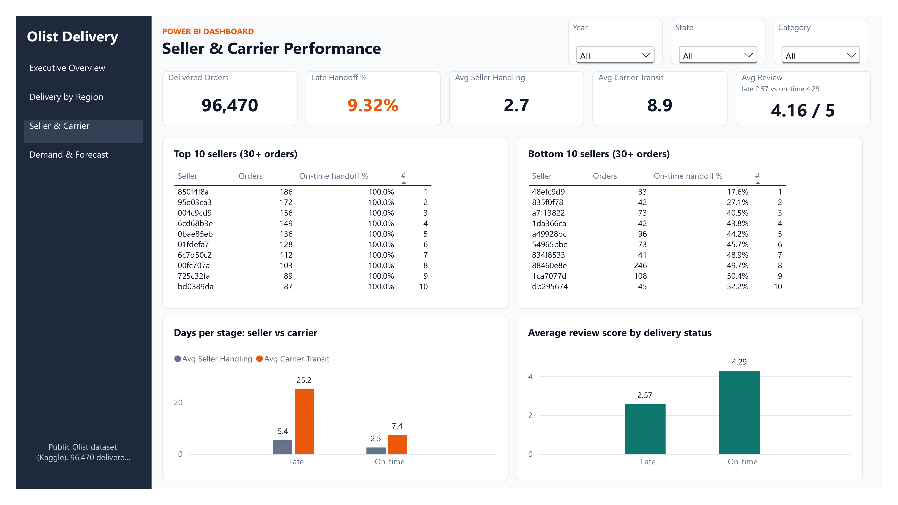
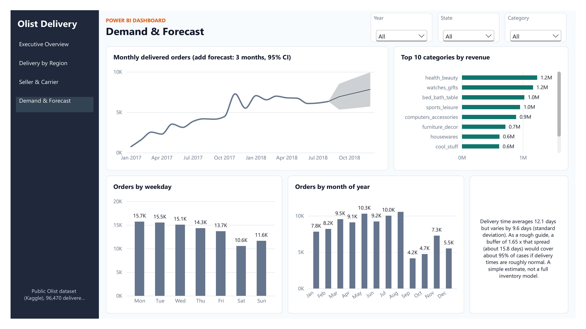

# Delivery & Seller Performance Analytics (Olist) – Power BI

A four-page Power BI dashboard on the public **Olist Brazilian e-commerce** dataset. It measures how reliably **96,470 delivered orders** reached customers, where and why they were late, which sellers drive the problem, and what demand looks like.

**Author:** Mohammed Aref Sultan · [GitHub](https://github.com/mohdaref12345-hash)

## Links

| | |
|---|---|
| Portfolio page (all dashboards explained) | https://mohdaref12345-hash.github.io/olist-delivery-seller-analytics/ |
| Power BI report file | [`Olist_Delivery_Dashboard.pbix`](https://github.com/mohdaref12345-hash/olist-delivery-seller-analytics/blob/main/Olist_Delivery_Dashboard.pbix) (open in Power BI Desktop, data included) |
| PDF copy of the report | [`Olist_Dashboard.pdf`](Olist_Dashboard.pdf) |
| Repository | https://github.com/mohdaref12345-hash/olist-delivery-seller-analytics |

## Headline finding

Carrier transit, not seller handling, drives late orders: **25.2 days** in transit for late orders versus **7.4** for on-time ones. Late orders also score **2.57** in reviews versus **4.29**.

| KPI | Value |
|---|---|
| On-time delivery (OTD) | 91.9% (8.1% late) |
| Average delivery (purchase to door) | 12.1 days |
| Average delay on late orders | 8.9 days |
| Average review | 4.16 / 5 |
| Revenue | 13.2M |
| Freight as a share of revenue | 16.6% |

> The KPI is **OTD** (on-time delivery), not OTIF: the dataset has no in-full information.

## Dashboards

### 1. Executive Overview


### 2. Delivery by Region


### 3. Seller & Carrier Performance


### 4. Demand & Forecast


## Project scope

**Business question:** where is delivery performance breaking down, and is the cause the seller or the carrier?

**In scope**
- Delivered orders only (status "delivered" with a customer delivery date): 96,470 orders.
- Four report pages with shared Year, State and Category slicers: Executive Overview, Delivery by Region, Seller & Carrier, Demand & Forecast.
- On-time delivery, delay by stage (seller handling vs carrier transit), regional and seller rankings, review impact, revenue and freight, demand trends and a 3-month forecast.
- Ranking rules to avoid small-sample noise: states, months and categories need **500+ delivered orders**; sellers need **30+ orders**.

**Out of scope / limitations**
- Static data: the report is built on Excel files and has no scheduled refresh.
- No OTIF, and no analysis of payments or geolocation (see data sources below).
- The map uses approximate state-capital coordinates, not state centroids. It is a scatter-plot bubble map because Power BI's built-in map visuals depend on Bing Maps, which is being retired.
- The forecast is Power BI's built-in line-chart forecast (3 months, 95% confidence band). It is a rough guide only.
- The month-of-year chart is not like-for-like: January to August cover two years, September to December only one.

## Data sources

Source: Olist Brazilian E-Commerce Public Dataset (Kaggle). The nine Excel files are in [`data/`](data/). The file names on GitHub are shortened; the Power BI project still points to the original names shown in the second column.

| File in `data/` | Original file name (used in the project) | What it contains | Used in the report |
|---|---|---|---|
| `olist_orders.xlsx` | `olist_orders_dataset.xlsx` | Order status and timestamps (purchase, carrier, delivery, estimate) | Yes: `orders` table (delivered only) |
| `olist_order_items.xlsx` | `olist_order_items_dataset.xlsx` | Items per order: seller, product, price, freight, shipping limit | Yes: `order_items` |
| `olist_customers.xlsx` | `olist_customers_dataset.xlsx` | Customer city and state | Yes: `customers` |
| `olist_sellers.xlsx` | `olist_sellers_dataset.xlsx` | Seller city and state | Yes: `sellers` |
| `olist_products.xlsx` | `olist_products_dataset.xlsx` | Product to category | Yes: `products` |
| `olist_categories.xlsx` | `product_category_name_translation.xlsx` | Category names in Portuguese and English | Yes: joined into `products` |
| `olist_reviews.xlsx` | `olist_order_reviews_dataset.xlsx` | Review score per order | Yes: `order_reviews` (average per order) |
| `olist_payments.xlsx` | `olist_order_payments_dataset.xlsx` | Payment type and value | No: defined as a query, not used by any visual |
| `olist_geolocation.xlsx` | `olist_geolocation_dataset - Copy - Copy.xlsx` | Zip-code coordinates | No: defined as a query, not used by any visual (map coordinates come from a small state table instead) |

## Calculations used

All logic is in Power Query, calculated columns and DAX measures. The raw tables are never edited. Full code: [`docs/measures.dax`](docs/measures.dax).

**Power Query (data preparation)**
- Keep only delivered orders with a customer delivery date, shared by the orders, items and reviews tables.
- Join product categories to their English names (fall back to the Portuguese name, then "Unknown").
- Average review score per order (551 repeat reviews are averaged): 99,224 raw rows become 95,824 clean rows.

**Calculated columns**

| Column | Logic |
|---|---|
| `Delivery Days` | delivered date − purchase date (whole days) |
| `Is Late` / `Delivery Status` | 1 / "Late" when delivered date is after the estimated date |
| `Delay Days` | days after the estimate, never below 0 |
| `Seller Handling Days` | carrier pick-up date − purchase date |
| `Carrier Transit Days` | customer delivery date − carrier pick-up date |
| `Seller Late Handoff Flag` | carrier pick-up after the seller's shipping limit date |
| `State Name` | state code to state name |
| `Seller Short` | first 8 characters of the seller ID (unique across all 3,095 sellers) |

**DAX measures (45), by group**
- **Delivery:** Delivered Orders, Late Delivery %, On-Time Delivery %, Avg Delivery Days, Avg Delay (Late Orders), Avg Seller Handling, Avg Carrier Transit.
- **Reviews:** Avg Review Score, Review Score (Late), Review Score (On-Time).
- **Revenue and freight:** Revenue, Revenue (M), Freight Cost, Freight % of Revenue.
- **Sellers:** Seller Orders, Late Handoff %, Seller On-Time Handoff %, Seller Rank Key, Seller Rank (Top / Bottom) with the 30-order rule.
- **500+ rules and rankings:** Late Rank (500+ States), Qualifying State Count, Show State (Top 6 + Bottom 3), Month In Window, Month OTD Rank (Lowest), Late % (States 500+), Late % (Highest 6 / Other States), OTD (Lowest 3 Months).
- **Map:** Map Lat, Map Lng (lookup in a small hidden table of 27 state coordinates).
- **Dynamic text and colours:** key-findings text, KPI sub-labels, chart titles, bar and marker colours, and a safety-stock note (1.65 × standard deviation of delivery days for a 95% service level).

**Model:** relationships from `orders` to `customers`, `order_items` to `orders`, `order_reviews` to `orders`, `order_items` to `sellers`, `order_items` to `products`, and `orders` to a calendar `Date` table (September 2016 to October 2018).

**Verification:** the headline numbers were checked three ways: the report model, independent DAX on the raw tables, and Python on the original CSV files. All match. See [`docs/reconciliation.csv`](docs/reconciliation.csv) and [`docs/verification_queries.dax`](docs/verification_queries.dax).

## Tools and technologies

- **Power BI Desktop**: report design, data model, PBIP project format (TMDL and PBIR text files)
- **Power Query (M)**: data preparation
- **DAX**: calculated columns and measures
- **Microsoft Excel files**: data sources
- **Python**: independent verification against the original CSV files
- **Git and GitHub**: version control, hosting
- **HTML and CSS with GitHub Pages**: portfolio page

## Project files

```
README.md
index.html                       portfolio page (also served by GitHub Pages)
Olist_Delivery_Dashboard.pbix    report file, data included
Olist_Dashboard.pdf              the report as a PDF
images/                          the four report pages in 4K
data/                            the nine Olist source Excel files
powerbi/                         Power BI project source (PBIP)
  Olist_Delivery_Dashboard.pbip
  Olist_Delivery_Dashboard.Report/          pages, visuals, theme
  Olist_Delivery_Dashboard.SemanticModel/   tables, relationships, measures (TMDL)
docs/
  measures.dax                   all 45 DAX measures
  verification_queries.dax       independent checks
  reconciliation.csv             A / B / C comparison results
  MODEL_NOTES.md                 model notes and known gaps
  Olist_Theme.json               report colour theme
```

## Open the report

**Quickest:** download `Olist_Delivery_Dashboard.pbix` and open it in Power BI Desktop. The data is already inside the file.

**Or open the project source:**
1. In Power BI Desktop, enable the **Power BI Project (.pbip)** preview feature.
2. Open `powerbi/Olist_Delivery_Dashboard.pbip`.
3. Point the data sources to your local copy of `data/` (Transform data, then Data source settings). The project's original paths are `C:\Users\isc\OneDrive\Attachments\`, with the original file names listed above.
4. Refresh.

## Author

**Mohammed Aref Sultan** – Power BI / data analytics. GitHub: [mohdaref12345-hash](https://github.com/mohdaref12345-hash)
