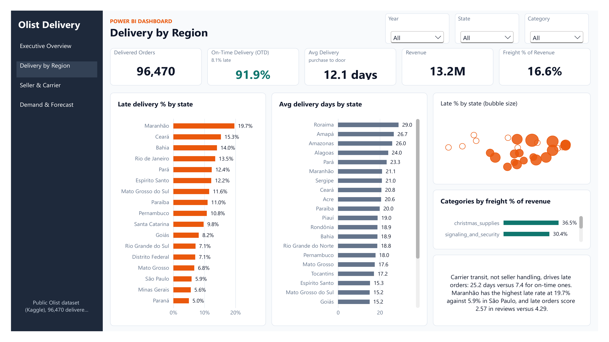
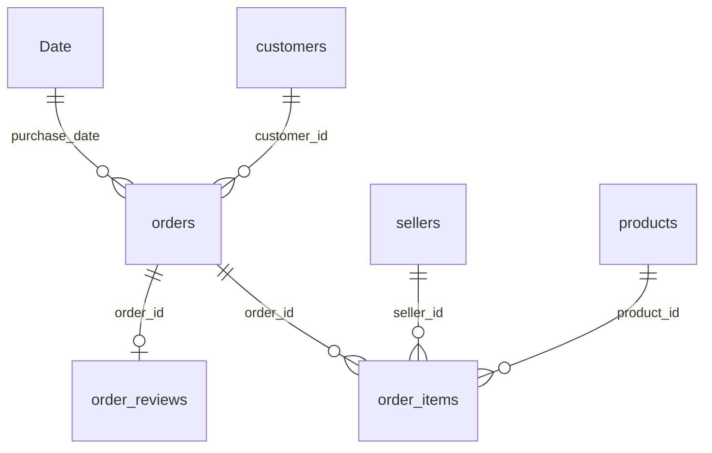

<div align="center">

# Delivery & Seller Performance Analytics

**Where do e-commerce deliveries go wrong, and who is responsible: the seller or the carrier?**

A four-page Power BI dashboard on 96,470 delivered Olist orders, built with live DAX measures and verified three ways.

[**Portfolio page**](https://mohdaref12345-hash.github.io/olist-delivery-seller-analytics/) ·
[**Power BI file (.pbix)**](Olist_Delivery_Dashboard.pbix) ·
[**PDF**](Olist_Dashboard.pdf) ·
[**DAX measures**](docs/measures.dax)

<a href="images/01_Executive_Overview.png"></a>

</div>

---

## Contents

[Result in brief](#result-in-brief) · [Business problem](#business-problem) · [Key findings and suggested actions](#key-findings-and-suggested-actions) · [The four dashboards](#the-four-dashboards) · [Data and model](#data-and-model) · [Method](#method) · [Scope and limitations](#scope-and-limitations) · [Tools](#tools) · [Repository](#repository) · [Open the report](#open-the-report) · [Author](#author)

## Result in brief

Late orders are a **carrier-transit problem, not a seller-handling problem**. Late orders spend **25.2 days** with the carrier versus **7.4** for on-time ones, while seller handling differs by only about three days. Late orders also cost customer satisfaction: **2.57** average review versus **4.29**.

| On-time delivery | Avg delivery | Avg delay (late orders) | Avg review | Revenue | Freight / revenue |
|:---:|:---:|:---:|:---:|:---:|:---:|
| **91.9%** | **12.1 days** | **8.9 days** | **4.16 / 5** | **13.2M** | **16.6%** |

> The KPI is **OTD** (on-time delivery), not OTIF, because the dataset has no in-full information. An order is late when it arrives after the estimated delivery date.

## Business problem

An online marketplace promises a delivery date. When it is missed, customers rate the experience lower. The questions this project answers:

1. How reliable is delivery overall, and how has it changed over time?
2. Which regions are slow or late, and where does freight take a large share of revenue?
3. Is the delay created by sellers (handing orders over late) or by the carrier (transit)?
4. Which sellers need attention first?
5. What does demand look like, and how much buffer does variable delivery time require?

## Key findings and suggested actions

| # | Finding | Evidence |
|---|---|---|
| 1 | The carrier, not the seller, drives lateness | Transit 25.2 days (late) vs 7.4 (on-time); seller handling 5.4 vs 2.5 |
| 2 | Lateness is concentrated in the north and north-east | Late rate: Maranhão 19.7%, Ceará 15.3%, Bahia 14.0%, vs São Paulo 5.9%. Slowest average delivery: Roraima 29.0 days, Amapá 26.7, Amazonas 26.0 |
| 3 | A few high-volume sellers hurt performance | Ten best sellers are at 100% on-time hand-off; the ten worst range from 17.6% to 52.2%, one with 246 orders at 49.7% |
| 4 | Lateness has a direct customer cost | Average review 2.57 for late orders vs 4.29 on time |
| 5 | Freight weight varies widely by category | 16.6% of revenue overall, but christmas_supplies 36.5% and signaling_and_security 30.4% |

**Suggested actions (analyst view, based on the patterns above; the data shows association, not proven cause):**
- Prioritise carrier performance and escalation in the six highest-late states (MA, CE, BA, RJ, PA, ES) before working on seller processes.
- Open a performance review with the worst sellers, starting with the high-volume ones.
- Set more realistic delivery estimates for the slowest states, so the promise matches what the carrier delivers.
- Plan about 15.8 extra days of demand as safety stock for a 95% service level (delivery time averages 12.1 days with a standard deviation of 9.6).
- Review pricing or shipping terms for the categories where freight is a large share of revenue.

## The four dashboards

All pages share a left sidebar for navigation and three slicers (**Year, State, Category**) that filter every page. Click an image to open the 4K version.

### 1. Executive Overview
<a href="images/01_Executive_Overview.png"></a>

**Answers:** how are we doing overall, when did it go wrong, and at which stage is the delay?

- Five KPI cards, and on-time delivery by month (Jan 2017 to Aug 2018) with the three lowest months in orange.
- Late % by customer state (states with 500+ orders only): six worst in orange, best three in teal.
- Days per stage, seller handling versus carrier transit, for late and on-time orders.
- A key-findings text box written by a DAX measure, so it follows the slicers.

### 2. Delivery by Region
<a href="images/02_Delivery_by_Region.png"></a>

**Answers:** which states are slow or late, and where is freight heavy?

- Late % and average delivery days by state (17 states with 500+ orders).
- A bubble map of late % (bubble size is the late rate).
- Categories ranked by freight as a share of revenue.

### 3. Seller & Carrier Performance
<a href="images/03_Seller_and_Carrier.png"></a>

**Answers:** who hands orders to the carrier late, and is the problem the seller or the carrier?

- Top 10 and bottom 10 sellers by on-time hand-off. Only sellers with 30+ orders are ranked, so a seller with a handful of orders cannot top the table. Ties are broken by order volume.
- Days per stage and average review score, late versus on-time.
- Late hand-off is 9.32% of order items; seller handling averages 2.7 days and carrier transit 8.9.

### 4. Demand & Forecast
<a href="images/04_Demand_and_Forecast.png"></a>

**Answers:** how is demand trending, which categories earn the revenue, and how much buffer is needed?

- Monthly delivered orders with a 3-month forecast and 95% confidence band (Power BI's built-in forecast; the wide band means it is a rough guide).
- Top 10 categories by revenue (health_beauty and watches_gifts about 1.2M each), orders by weekday (Monday busiest at 15.7K, Saturday quietest at 10.6K) and by month.
- A safety-stock note calculated by DAX from the spread of delivery times.
- Read the month-of-year chart with care: January to August cover two years of data, September to December only one.

## Data and model

**Source:** [Olist Brazilian E-Commerce Public Dataset](https://www.kaggle.com/datasets/olistbr/brazilian-ecommerce) (Kaggle). The nine Excel files are in [`data/`](data/); their names on GitHub are shortened, and the Power BI project still points to the original names.

| File in `data/` | Original name (used in the project) | Content | In the report |
|---|---|---|:---:|
| `olist_orders.xlsx` | `olist_orders_dataset.xlsx` | Order status and timestamps | Yes |
| `olist_order_items.xlsx` | `olist_order_items_dataset.xlsx` | Seller, product, price, freight, shipping limit | Yes |
| `olist_customers.xlsx` | `olist_customers_dataset.xlsx` | Customer city and state | Yes |
| `olist_sellers.xlsx` | `olist_sellers_dataset.xlsx` | Seller city and state | Yes |
| `olist_products.xlsx` | `olist_products_dataset.xlsx` | Product to category | Yes |
| `olist_categories.xlsx` | `product_category_name_translation.xlsx` | Category names, Portuguese and English | Yes |
| `olist_reviews.xlsx` | `olist_order_reviews_dataset.xlsx` | Review score per order | Yes |
| `olist_payments.xlsx` | `olist_order_payments_dataset.xlsx` | Payment type and value | No |
| `olist_geolocation.xlsx` | `olist_geolocation_dataset - Copy - Copy.xlsx` | Zip-code coordinates | No |

The last two files are defined as Power Query queries but no visual uses them. Map coordinates come from a small hidden table of 27 state capitals instead.



## Method

1. **Prepare (Power Query).** Keep only delivered orders with a customer delivery date (96,470). Join product categories to their English names. Average review score per order: 99,224 raw rows become 95,824 (2,849 orders not delivered, and 551 repeat reviews averaged). The raw tables are never edited.
2. **Model.** Six relationships (above) plus a calendar `Date` table for September 2016 to October 2018.
3. **Calculate (DAX).** Delay, stage and flag columns, then 45 measures that drive every number, text and colour on the dashboards. Nothing is hard-coded.
4. **Rank fairly.** States, months and categories need **500+ delivered orders** to be ranked; sellers need **30+ orders**.
5. **Verify.** Headline numbers were checked three ways: the report model, independent DAX on the raw tables, and Python on the original CSV files. All match ([results](docs/reconciliation.csv), [queries](docs/verification_queries.dax)).

<details>
<summary><b>Calculated columns</b></summary>

| Column | Logic |
|---|---|
| `Delivery Days` | delivered date − purchase date (whole days) |
| `Is Late` / `Delivery Status` | late when delivered date is after the estimated date |
| `Delay Days` | days after the estimate, never below 0 |
| `Seller Handling Days` | carrier pick-up date − purchase date |
| `Carrier Transit Days` | customer delivery date − carrier pick-up date |
| `Seller Late Handoff Flag` | carrier pick-up after the seller's shipping limit date |
| `State Name` | state code to state name |
| `Seller Short` | first 8 characters of the seller ID (unique across all 3,095 sellers) |

</details>

<details>
<summary><b>DAX measures (45), by group</b></summary>

- **Delivery:** Delivered Orders, Late Delivery %, On-Time Delivery %, Avg Delivery Days, Avg Delay (Late Orders), Avg Seller Handling, Avg Carrier Transit
- **Reviews:** Avg Review Score, Review Score (Late), Review Score (On-Time)
- **Revenue and freight:** Revenue, Revenue (M), Freight Cost, Freight % of Revenue
- **Sellers:** Seller Orders, Late Handoff %, Seller On-Time Handoff %, Seller Rank Key, Seller Rank (Top / Bottom)
- **Rules and rankings:** Late Rank (500+ States), Qualifying State Count, Show State (Top 6 + Bottom 3), Month In Window, Month OTD Rank (Lowest), Late % (States 500+), Late % (Highest 6 / Other States), OTD (Lowest 3 Months)
- **Map:** Map Lat, Map Lng
- **Dynamic text and colour:** key-findings text, KPI sub-labels, chart titles, bar and marker colours, safety-stock note (1.65 × standard deviation of delivery days)

Full code: [`docs/measures.dax`](docs/measures.dax)

```dax
Seller Rank (Top) =
IF([Seller Orders] >= 30,
   RANKX(FILTER(ALLSELECTED(sellers[Seller Short]), [Seller Orders] >= 30),
         [Seller Rank Key], , DESC, DENSE))
```

</details>

## Scope and limitations

**In scope:** delivered orders only; four report pages; on-time delivery, delay by stage, regional and seller rankings, review impact, revenue and freight, demand and a 3-month forecast.

**Limitations**
- Static data: built on Excel files, with no scheduled refresh.
- OTD only (no OTIF), and no analysis of payments or geolocation.
- The map is a scatter-plot bubble map on approximate state-capital coordinates (checked against IBGE data, all within about 0.1 degree), because Power BI's built-in maps depend on Bing Maps, which is being retired.
- The forecast is rough, and the month-of-year chart is not like-for-like (see Dashboard 4).
- Findings show patterns and association, not proven causes.

## Tools

Power BI Desktop (PBIP project, TMDL and PBIR text files) · Power Query (M) · DAX · Excel (sources) · Python (verification) · Git and GitHub · HTML and CSS on GitHub Pages (portfolio page)

## Repository

```
README.md
index.html                       portfolio page (served by GitHub Pages)
Olist_Delivery_Dashboard.pbix    report file, data included
Olist_Dashboard.pdf              the report as a PDF
images/                          the four report pages in 4K
data/                            the nine source Excel files
powerbi/                         project source (PBIP)
  Olist_Delivery_Dashboard.pbip
  Olist_Delivery_Dashboard.Report/          pages, visuals, theme
  Olist_Delivery_Dashboard.SemanticModel/   tables, relationships, measures (TMDL)
docs/
  measures.dax                   all 45 DAX measures
  verification_queries.dax       independent checks
  reconciliation.csv             report vs raw-table vs Python results
  MODEL_NOTES.md                 model notes and known gaps
  Olist_Theme.json               colour theme
```

## Open the report

**Quickest:** download [`Olist_Delivery_Dashboard.pbix`](Olist_Delivery_Dashboard.pbix) and open it in Power BI Desktop. The data is inside the file.

**Project source:**
1. In Power BI Desktop, enable the **Power BI Project (.pbip)** preview feature.
2. Open `powerbi/Olist_Delivery_Dashboard.pbip`.
3. Point the data sources to your local copy of `data/` (Transform data, then Data source settings). The project's original paths are `C:\Users\isc\OneDrive\Attachments\`, with the original file names listed above.
4. Refresh.

## Author

**Mohammed Aref Sultan** · Power BI and data analytics · [GitHub](https://github.com/mohdaref12345-hash)

Data: Olist Brazilian E-Commerce Public Dataset (Kaggle).
