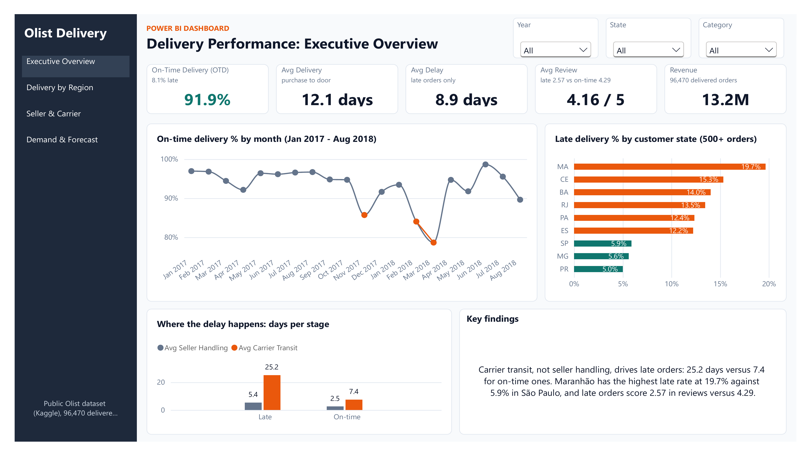

# Delivery & Seller Performance Analytics (Olist)

An interactive Power BI dashboard that analyses delivery performance and seller performance for an e-commerce marketplace, using the public Olist Brazilian E-Commerce dataset.

**Live portfolio page:** https://mohdaref12345-hash.github.io/olist-delivery-seller-analytics/

## Table of Contents

- [Overview](#overview)
- [Objectives](#objectives)
- [Dataset](#dataset)
- [Dashboard Screenshots](#dashboard-screenshots)
- [Key Insights](#key-insights)
- [Tools and Technologies](#tools-and-technologies)
- [Project Structure](#project-structure)
- [How to Run the Project](#how-to-run-the-project)
- [Author](#author)

## Overview

The project analyses **96,470 delivered orders** and shows how reliably they reached customers, where and when delays happen, and which sellers, states and categories need attention. The main KPI is **On-Time Delivery (OTD)**: an order is late when it arrives after the estimated delivery date.

The report has four pages: Executive Overview, Delivery by Region, Seller & Carrier Performance, and Demand & Forecast. All pages share the same filters (Year, State, Category).

## Objectives

- Measure on-time delivery and track it over time.
- Find which states are slow or late.
- Find out whether delays are caused by the seller or by the carrier.
- Rank the best and worst sellers.
- Understand demand, top categories and the buffer stock needed.

## Dataset

Source: [Olist Brazilian E-Commerce Public Dataset](https://www.kaggle.com/datasets/olistbr/brazilian-ecommerce) (Kaggle). The nine Excel files are in the [`data/`](data/) folder.

| File | Content |
|---|---|
| `olist_orders.xlsx` | Orders, status and timestamps |
| `olist_order_items.xlsx` | Items per order: seller, product, price, freight |
| `olist_customers.xlsx` | Customer city and state |
| `olist_sellers.xlsx` | Seller city and state |
| `olist_products.xlsx` | Product to category |
| `olist_categories.xlsx` | Category names (Portuguese and English) |
| `olist_reviews.xlsx` | Review score per order |
| `olist_payments.xlsx` | Payments (not used in the report) |
| `olist_geolocation.xlsx` | Zip-code coordinates (not used in the report) |

Only delivered orders are analysed. States, months and categories need 500+ orders to be ranked, and sellers need 30+ orders.

## Dashboard Screenshots

### 1. Executive Overview
<a href="images/01_Executive_Overview.png"></a>

KPI cards (OTD 91.9%, average delivery 12.1 days, average delay 8.9 days, average review 4.16 / 5, revenue 13.2M), on-time delivery by month, late delivery by state, and days per stage (seller handling vs carrier transit).

### 2. Delivery by Region
<a href="images/02_Delivery_by_Region.png"></a>

Late delivery % and average delivery days by state, a bubble map, and freight as a share of revenue by category (16.6% overall).

### 3. Seller & Carrier Performance
<a href="images/03_Seller_and_Carrier.png"></a>

Top 10 and bottom 10 sellers by on-time hand-off (late hand-off 9.32%), days per stage, and review score by delivery status.

### 4. Demand & Forecast
<a href="images/04_Demand_and_Forecast.png"></a>

Monthly orders with a 3-month forecast, top 10 categories by revenue, orders by weekday and month, and a delivery-time buffer note.

## Key Insights

- **The carrier causes most of the delay.** Late orders spend 25.2 days in transit versus 7.4 days for on-time orders. Seller handling is 5.4 versus 2.5 days.
- **Late orders get lower reviews.** The average review is 2.57 for late orders and 4.29 for on-time orders.
- **Delays are highest in the north and north-east.** Late rate: Maranhão 19.7%, Ceará 15.3%, Bahia 14.0%, compared with São Paulo 5.9%. Slowest average delivery: Roraima 29.0 days, Amapá 26.7 days, Amazonas 26.0 days.
- **Seller performance varies widely.** The 10 best sellers hand over on time 100% of the time. The 10 worst range from 17.6% to 52.2%, and one of them has 246 orders at 49.7%.
- **Freight is heavy for some categories.** It is 16.6% of revenue overall, but 36.5% for christmas_supplies and 30.4% for signaling_and_security.
- **Demand.** Health_beauty and watches_gifts lead revenue at about 1.2M each. Monday is the busiest day (15.7K orders) and Saturday the quietest (10.6K).
- **Safety stock.** Delivery time averages 12.1 days with a standard deviation of 9.6, so a buffer of about 15.8 days (1.65 × the standard deviation) would cover roughly 95% of cases if delivery times are roughly normal. This is a simple estimate, not a full inventory model.

## Tools and Technologies

- Power BI Desktop (report and data model)
- Power Query (data preparation)
- DAX (45 measures and calculated columns, see [`docs/measures.dax`](docs/measures.dax))
- Microsoft Excel (data sources)
- Python (independent check of the numbers, see [`docs/reconciliation.csv`](docs/reconciliation.csv))
- Git and GitHub

## Project Structure

```
.
├── README.md
├── index.html                       # portfolio page
├── Olist_Delivery_Dashboard.pbix    # Power BI report (data included)
├── Olist_Dashboard.pdf              # report as PDF
├── images/                          # dashboard screenshots (4K)
├── data/                            # the nine source Excel files
├── powerbi/                         # Power BI project source (.pbip)
└── docs/
    ├── measures.dax                 # all DAX measures
    ├── verification_queries.dax     # queries used to check the numbers
    ├── reconciliation.csv           # verification results
    ├── MODEL_NOTES.md               # model notes
    └── Olist_Theme.json             # colour theme
```

## How to Run the Project

You need **Power BI Desktop** (free, Windows).

### Option 1: open the report file (quickest)

1. Open [`Olist_Delivery_Dashboard.pbix`](Olist_Delivery_Dashboard.pbix) on GitHub and click the **Download raw file** icon (the file is about 52 MB).
2. Open the downloaded file with Power BI Desktop.

The data is stored inside the `.pbix` file, so the report works right away without the Excel files.

### Option 2: open the project source (.pbip)

1. In Power BI Desktop, enable the **Power BI Project (.pbip)** preview feature first (File, then Options and settings, then Options, then Preview features).
2. Download the repository (**Code, then Download ZIP**) and unzip it.
3. Open `powerbi/Olist_Delivery_Dashboard.pbip` in Power BI Desktop.
4. Point the data sources to your local copy of the `data/` folder: **Transform data, then Data source settings**, and change each file path. The file names in `data/` are shorter than the names used in the report (for example `olist_orders.xlsx` is `olist_orders_dataset.xlsx` in the report).
5. Click **Refresh**.

## Author

**Mohammed Aref Sultan**
GitHub: [mohdaref12345-hash](https://github.com/mohdaref12345-hash)  
LinkedIn: [Mohammed Sultan](https://www.linkedin.com/in/mohammed-sultan-b2b0473a3/)
